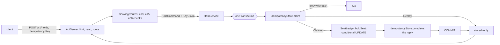

# Architecture

## The contract first

`openapi/seatwave-api.yaml` (OpenAPI 3.1.2) is the source of truth. The code follows it, and the build checks both directions:

- the document itself: the OpenAPI parser's validation and the house rules in `ContractRules` (`OpenApiDocumentTest`, and `./gradlew -q lintContract` by hand);
- every reply of the running service: `TestApi.send` passes each reply to the Atlassian validator, which judges the status code, the media type, the required fields and the error body's shape against the document; any mismatch fails the test that caused it;
- every change: `BreakingChangeTest` compares the document with the last released one, `openapi/released/seatwave-api-1.0.0.yaml`, with openapi-diff and with the house rules in `BreakingChanges`.

## The packages

| Package | What it owns |
|---|---|
| `io.plainround.seatwave.api` | `ContractLimits` (the numbers the document publishes), `SeatWaveApi` (wires one running API), `ServeCli`. |
| `config` | `SettingsReader` (typed values, every problem collected, no defaults) and `ApiSettings` (records that validate themselves). |
| `store` | `Database` (embedded H2, versioned migrations under `src/main/resources/db/migration`, each safe to run again, one short connection per unit of work) and `DemoSeed`. |
| `idempotency` | `IdempotencyKey`, `Fingerprint`, `KeyClaim`, `StoredReply`, `ClaimResult` and `IdempotencyStore`, which works only inside the caller's transaction. |
| `catalog` | `CatalogService` (keyset pages of events and seats), `Cursors`, `Page`, `Position`, `SeatFilter` and the summaries. |
| `booking` | `HoldService`, `ConfirmService`, `SeatLedger` (the SQL), the commands, the outcomes and `Refusal`. |
| `payment` | `PaymentClient` (one JDK `HttpClient`, timeouts, the provider's key made from the hold) and the stand-in provider `PaymentStandIn` with its CLI. |
| `json` | `JsonCodec`: Jackson bound to known records; unknown fields, coercions (a number or a boolean for a string too), numbers out of range, trailing data and duplicates refused, each at its RFC 6901 pointer. |
| `http` | `ApiServer` (the JDK's `com.sun.net.httpserver` on 127.0.0.1, virtual threads, an in-flight limit), the routes of version 1 and version 0, `Problems` (the one error mapping), the views and `ApiMetrics`. |
| `load` | `RetryStorm` and `PageWalk` with their CLIs, the rejected alternative `OffsetSeatReader`, kept only to measure it, and `KeyStoreSizeCli`, which measures the bytes one stored key costs. |

## The dependency rule

- `idempotency`, `catalog` and `booking` know nothing of HTTP. They take and return records; `booking` stores whatever reply the caller renders, through a function it is given.
- `http` depends on everything below it and is the only package that knows status codes, media types and JSON shapes.
- `payment` is the only package that leaves the process, and only to 127.0.0.1.
- The `*Cli` classes are the only code that prints or exits. Logging goes to standard error.

## The data flow of one keyed write

The confirm adds a remote call, so it is three steps: a transaction that claims the key and leases the seat (HELD to CONFIRMING), the call to the provider outside any transaction with the provider key `seatwave-hold-<holdId>`, and a transaction that writes the booking, marks the seat CONFIRMED and stores the reply. If the provider does not confirm, the lease is ended and nothing is stored; the client's retry with the same key resumes at step 1, and the provider's key makes the second call name the same charge.

## Walk-throughs

**One hundred retries with one key, at once.** All hundred insert the same (endpoint, key) row. The first insert takes the row's lock; the other 99 wait on the primary key. The first transaction holds the seat, stores its reply and commits. Each waiter then gets a unique-key violation, reads the row, sees the same fingerprint and COMPLETED, and sends the stored reply. One seat held, one key row, one hundred identical replies.

**Two requests with one expired key, at once.** Both read the expired row. Each tries to take it over with one conditional `UPDATE ... WHERE expires_at <= now`; the first takes the row's lock and does the work, the second waits on that lock. When the first commits, the second's condition is checked again under the lock, no longer matches, and the second reads the row the first left: the same body gets the first reply again, another body gets 422. One effect, two replies the contract defines.

**A crash between the seat and the key.** The seat UPDATE and the key's reply are in one transaction. The test installs an H2 trigger that fails the key write: the database rolls back the seat too, the client gets 503, and its retry finds nothing and does the work once.

**A page of seats.** The cursor carries the event, the filters and the last seat's (section, number). The next page is "the next `limit + 1` rows after that position", one indexed query; the extra row says whether another page exists. A seat that is held or added before the position cannot move it.

## Decisions and trade-offs

- **The JDK's HTTP server and JSON with Jackson.** The module is about the contract, not a framework. `com.sun.net.httpserver` is an exported, supported JDK module (`jdk.httpserver`); Jackson is the course's approved JSON library, because the JDK has no JSON parser.
- **The key row in the same transaction as the effect.** Any other order leaves a moment when one exists without the other, and a crash in that moment is either a lost reply (the effect without the key: the retry acts again) or a lie (the key without the effect: the retry is told it worked).
- **Store final outcomes, not transient ones.** A 201, a 404 or a 409 seat-unavailable is stored and replayed; a 503 is not, so a retry with the same key can succeed later. A 400, 413, 415 or 422 is refused before the key is claimed.
- **A lease on the seat while paying.** The seat is CONFIRMING with a lease while the provider is called, so a second attempt cannot pay for it at the same time; after the lease, any attempt may take over, and the provider key stops a second charge. A seat whose payment outcome is unknown is never resold blindly.
- **Fingerprint the meaning, not the bytes.** The bound request is written back out before hashing, so a client that reorders fields or adds spaces is not told it changed its request.
- **Keyset cursors, never offsets.** Offsets count rows, so every row that leaves the filter or arrives before the position shifts the rest; `PageWalk` measures it.
- **Version 0 kept, unchanged, with deprecation headers.** Its paths answer as Module 1's did, with `Deprecation`, `Sunset` and `Link` headers; only the payment at confirm is new, because Module 2 requires it.
- **Migrations that are safe to run again.** H2 commits every DDL statement at once, so a script and its `schema_history` row are two commits, and a crash between them used to make the next start run the script again and fail on "already exists". Every statement is now written to be run again harmlessly (`CREATE ... IF NOT EXISTS`, `ADD COLUMN IF NOT EXISTS`, `ADD CONSTRAINT IF NOT EXISTS`, and an `UPDATE` that writes the same values), so the next start re-runs the script and records it; `DatabaseTest` simulates the crash by deleting the history rows. The rejected alternative was a "started" row written before each script: it detects the crash but cannot tell how far the script got, so start-up would stop until someone repaired the schema by hand. The re-runnable scripts also cover a crash in the middle of a script. The edits to V1 to V3 change no object they create.
- **No connection pool.** Opening a connection to an embedded H2 database that is already open costs microseconds; the in-flight limit (64 in `config/serve.properties`) bounds the connections in use.
- **A stand-in provider.** It deduplicates by key as real providers do, can capture and then time out, or fail without capturing, and never answers 2xx when told to fail. It moves no money and contacts nothing.

## Invariants, and where they are enforced

| Invariant | Where |
|---|---|
| One key produces at most one effect | Primary key `one_effect_per_key (endpoint, idempotency_key)`; the key row and the effect commit in one transaction (`HoldService.hold`, `ConfirmService.finish`); an expired key is taken over by one conditional `UPDATE` (`IdempotencyStore.claim`); `IdempotencyStore.complete` is first-wins |
| A reused key with a different body is refused | The fingerprint column, compared in `IdempotencyStore.claim` (422) |
| One seat, one holder | The conditional `UPDATE` of `SeatLedger.holdSeat` (Module 1) |
| A hold is found by its id without a table scan | Index `seats_by_hold` (V4), checked against H2's query plan by `DatabaseTest` |
| One booking per seat | Unique constraint `one_booking_per_seat` (Module 1) |
| One charge per hold | The provider key `seatwave-hold-<holdId>` (`PaymentClient.providerKeyFor`), deduplicated by the provider |
| No two confirms pay for one seat at once | The CONFIRMING lease of `SeatLedger.leaseForConfirm` |
| Every error of version 1 is problem details | `Problems`, the only place an error becomes a reply; checked on every reply by the contract tests |
| No page is larger than 500 items | `ContractLimits.MAX_PAGE_LIMIT`, checked against the document by `OpenApiDocumentTest` |
| No request leaves the machine | `ApiServer` and `PaymentStandIn` bind 127.0.0.1; `ApiSettings.Payment` accepts only `http://127.0.0.1:<port>`; the script allows only 127.0.0.1 |
